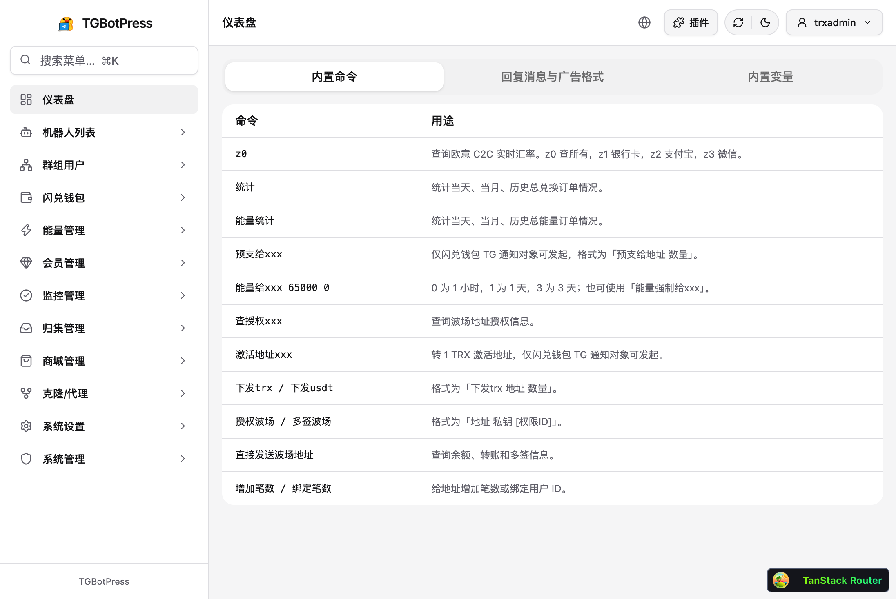
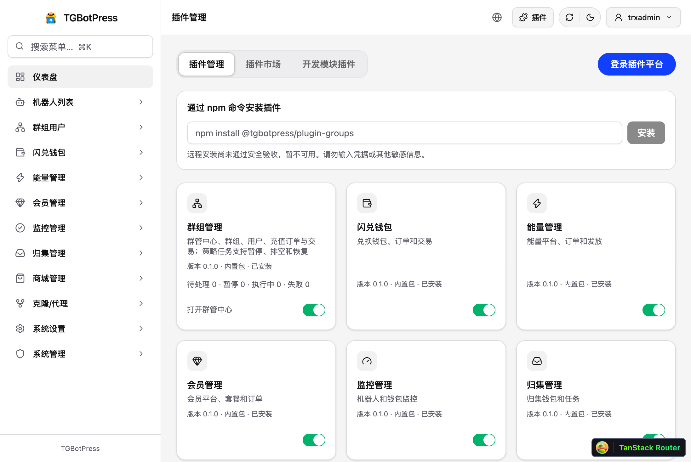
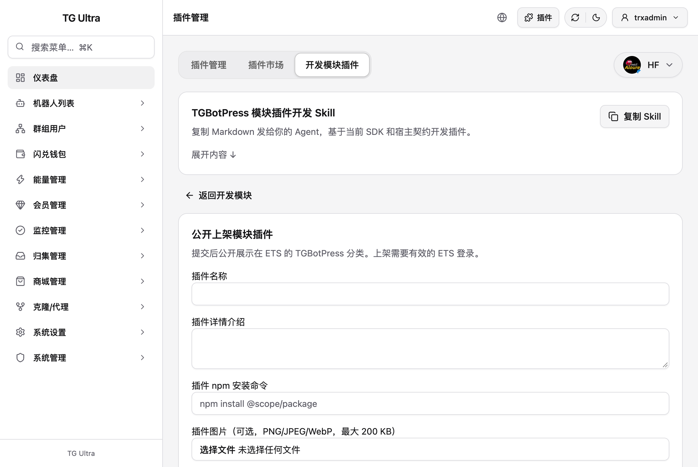

<div align="center">


# TGBotPress

**面向 Telegram Bot 的模块化管理基座与插件生态**

用可复用的基座、清晰的模块边界和插件开发接口，让机器人功能开发与管理更高效。

[](https://github.com/cnmbdb/TGBotPress/actions/workflows/docker-build.yml)
[](LICENSE)
[](https://nodejs.org/)
[](https://www.postgresql.org/)

[项目介绍](#项目介绍) · [开始使用](#开始使用) · [部署教程](#部署教程) · [插件开发](#插件开发) · [常见问题](#常见问题)

</div>

---

## 目录

- [项目介绍](#项目介绍)
- [界面预览](#界面预览)
- [功能模块](#功能模块)
- [技术栈](#技术栈)
- [开始使用](#开始使用)
- [部署教程](#部署教程)
- [插件开发](#插件开发)
- [源码开发与验证](#源码开发与验证)
- [项目结构](#项目结构)
- [常见问题](#常见问题)
- [参与贡献](#参与贡献)
- [许可证](#许可证)

## 项目介绍

TGBotPress 是一个以 **基座 + 模块插件 + 插件市场** 为方向的 Telegram Bot 项目。基座提供管理后台、数据库、机器人管理及插件生命周期等公共能力；开发者可以围绕业务模块组织代码，减少重复开发，用户则可按需要管理模块。

项目的目标是让开发者开发 Telegram Bot 模块，并向插件市场提交展示信息。基座源码采用 Apache-2.0 许可证开放，欢迎参与开发和完善生态。

> [!IMPORTANT]
> 项目仍在迭代。当前已有 SDK 类型、内置模块、生命周期管理和 ETS 市场信息提交入口；任意第三方插件的通用安装、动态路由和安全隔离尚未完成。**提交市场信息或成功打包，不代表插件已可自动安装运行。** 请先阅读[插件开发文档](docs/plugin-development.md)。

### 项目特点

- 🧩 **模块化组织**：将群组、商城、监控等业务划分为模块，按生命周期管理。
- 🤖 **面向 Telegram Bot**：围绕机器人配置、消息处理与后台管理组织能力。
- 🛠️ **开发者接口**：提供插件 SDK、manifest 类型和现有模块示例。
- 🛍️ **插件市场入口**：支持向 ETS 的 TGBotPress 分类提交插件展示信息。
- 🐳 **容器化交付**：使用 GitHub Actions 构建镜像并推送至 GHCR。

## 界面预览

点击截图可查看原图。

<table>
  <tr>
    <td align="center" width="50%"><a href="docs/images/screenshots/login.png"></a><br><strong>管理员登录</strong></td>
    <td align="center" width="50%"><a href="docs/images/screenshots/dashboard.png"></a><br><strong>管理后台</strong></td>
  </tr>
  <tr>
    <td align="center" width="50%"><a href="docs/images/screenshots/plugins.png"></a><br><strong>插件管理</strong></td>
    <td align="center" width="50%"><a href="docs/images/screenshots/plugin-development.png"></a><br><strong>插件开发</strong></td>
  </tr>
</table>

> [!NOTE]
> 截图展示当前界面；插件远程安装和第三方隔离的状态请以实际版本及[插件开发文档](docs/plugin-development.md)为准。

## 功能模块

| 模块 | 功能方向 |
| --- | --- |
| 群组管理 | 群组、用户、群管策略和充值记录 |
| 闪兑钱包 | 兑换钱包、订单与交易 |
| 能量管理 | 能量平台、套餐、订单和相关任务 |
| 会员管理 | 会员平台、套餐、订单和发放 |
| 监控管理 | 机器人与钱包监控 |
| 归集管理 | 归集钱包与任务，依赖闪兑模块 |
| 商城管理 | 商城机器人、商品、卡密与订单 |
| 克隆/代理 | 代理开户、商户和收益 |

模块以当前 [插件目录](src/plugins/catalog.ts) 为准。各模块的包化程度不同，部分业务仍由基座提供。

## 技术栈

| 层次 | 技术 |
| --- | --- |
| 应用框架 | TanStack Start、TanStack Router、React、TypeScript |
| 数据与界面 | PostgreSQL、TanStack Query、TanStack Table |
| UI | Tailwind CSS、Radix UI、shadcn/ui 组件 |
| 运行与交付 | Node.js 22、Docker、GitHub Actions、GitHub Container Registry |

## 开始使用

选择适合你的方式：

1. **体验和部署**：使用已构建镜像，按 [Docker Compose 教程](docs/deployment/docker-compose.md)启动应用和 PostgreSQL。
2. **开发功能**：克隆仓库，按照[源码开发与验证](#源码开发与验证)准备环境。
3. **开发插件**：从 [插件开发](#插件开发) 和 [完整开发文档](docs/plugin-development.md)开始。

> [!NOTE]
> GitHub Actions 已构建并推送 `ghcr.io/cnmbdb/tgbotpress:latest`。GHCR 新建包可能为私有；若拉取时提示未授权，请先使用有权读取该包的 GitHub 账号登录 GHCR，或由包所有者在 GitHub Packages 中调整可见性。公开匿名拉取状态请以实际仓库设置为准。

## 部署教程

根据服务器环境和数据库选择部署方式：

| 应用部署方式 | 数据库组合 | 教程 |
| --- | --- | --- |
| VPS / 宝塔 Node 项目 | 本机或独立 PostgreSQL | [宝塔 Node 方式部署](docs/deployment/baota-node.md) |
| VPS / 宝塔 Docker | PostgreSQL 容器及持久化数据卷 | [宝塔 Docker 方式部署](docs/deployment/baota-docker.md) |
| Docker Compose | 同机 PostgreSQL 容器及持久化数据卷 | [Docker Compose 快速部署](docs/deployment/docker-compose.md) |
| Node / Docker | 已有或托管 PostgreSQL | [数据库连接与组合](docs/deployment/databases.md) |

> [!IMPORTANT]
> 当前基座依赖 PostgreSQL。SQLite 文件、MySQL、Cloudflare D1 和 Hyperdrive **尚未适配**，不能直接替换数据库；详情和适用边界见[数据库连接与组合](docs/deployment/databases.md)。

## 插件开发

### 第一步：了解当前契约

从 [插件 SDK 类型](packages/plugin-sdk/src/index.d.ts)、[内置插件目录](src/plugins/catalog.ts) 和 [示例插件](packages/plugin-cloneproxy/) 开始。插件包通常使用 ESM，根入口导出 `manifest` 和 `plugin`：

```js
export const manifest = {
  id: 'example',
  version: '0.1.0',
  hostRange: '>=1.0.0 <2.0.0',
  sdkVersion: '0.1.0',
  name: '示例插件',
}

export const plugin = { manifest }
```

### 第二步：实现并接入

1. 创建插件包，定义 `package.json` 的 `exports`、JavaScript 与类型入口。
2. 实现业务逻辑，通过接口注入宿主能力，明确权限、数据库、任务与 Telegram 事件的边界。
3. 按当前宿主结构显式接入菜单、API 和任务；manifest 本身不会自动注册这些功能。
4. 在隔离环境测试权限、生命周期、失败重试、并发与在途业务，再检查打包内容：

```sh
cd packages/plugin-example  # 替换为你的插件目录
npm pack --dry-run
```

### 第三步：提交市场展示

在后台插件市场登录 ETS，填写插件名称、介绍、npm 安装命令和可选图片后提交。提交展示信息、发布 npm 包、宿主接入和安装验证是独立步骤。

> [!TIP]
> 插件生命周期、依赖、安全边界和市场提交条件见 **[完整插件开发文档](docs/plugin-development.md)**。第三方插件自动安装和隔离尚未完成，开发者应以当前源码和实测结果为准。

## 源码开发与验证

需要 Node.js 22、npm 和可访问的 PostgreSQL。仓库提供 `package-lock.json`，镜像构建使用 `npm ci`。

```sh
git clone https://github.com/cnmbdb/TGBotPress.git
cd TGBotPress
npm ci
```

设置 `DB_HOST`、`DB_PORT`、`DB_DATABASE`、`DB_USERNAME`、`DB_PASSWORD` 和 `PLATFORM_ORIGIN` 后运行 `npm run dev`；服务默认监听 8083。Vite 读取仓库根目录 `.env`。开发用数据库需要先具备基础表结构及迁移：镜像启动脚本可初始化空数据库，而 `npm run db:migrate` 只执行 `migrations/` 下的平台迁移，不能单独初始化空数据库。

```sh
npm run typecheck         # TypeScript 检查
npm test                  # 单元测试及脚本测试
npm run test:integration  # 集成测试，部分测试需隔离数据库或额外配置
npm run build             # 应用构建
```

测试前查看对应测试文件的环境要求。不要对真实支付、链上账户或生产数据库运行破坏性测试。

## 项目结构

```text
TGBotPress/
├── .github/workflows/    # GitHub Actions 镜像工作流
├── docs/                 # 插件开发文档
├── legacy/               # 数据库初始化所需基础结构与模板
├── migrations/           # 平台数据库迁移
├── packages/             # 插件 SDK 与模块包
├── public/               # 静态资源
├── scripts/              # 启动、迁移与辅助脚本
├── src/
│   ├── components/       # 界面组件
│   ├── plugins/          # 插件目录、注册与生命周期
│   ├── routes/           # 页面及 API 路由
│   ├── server/           # 服务端业务
│   └── worker/           # 后台任务入口
├── Dockerfile
└── package.json
```

## 常见问题

<details>
<summary><strong>拉取镜像时报未授权怎么办？</strong></summary>

检查包是否公开。私有包需要使用有权限的 GitHub 账号与具备相应包读取权限的凭据登录 GHCR；不要将凭据写进 Compose 文件或提交到仓库。

</details>

<details>
<summary><strong>启动失败或健康检查未通过怎么办？</strong></summary>

先查看 `docker compose logs app` 和 `docker compose logs postgres`。确认数据库健康、连接参数一致、空数据库已设置有效的初始管理员密码，且迁移没有报错。数据库就绪不代表 Telegram、支付或其他外部服务已经配置完成。

</details>

<details>
<summary><strong>为什么添加插件后没有自动出现页面？</strong></summary>

当前页面、API 和任务仍需按宿主结构接入，第三方动态路由尚未完成。请查看[插件开发文档](docs/plugin-development.md)和现有模块实现。

</details>

## 参与贡献

欢迎通过 [Issues](https://github.com/cnmbdb/TGBotPress/issues) 反馈问题或讨论功能，也欢迎提交 Pull Request。提交前请说明触发场景和验证方式；涉及数据库、支付、钱包或 Telegram 行为时，请特别说明迁移、权限、幂等和失败处理。

## 许可证

本项目采用 [Apache License 2.0](LICENSE)。
